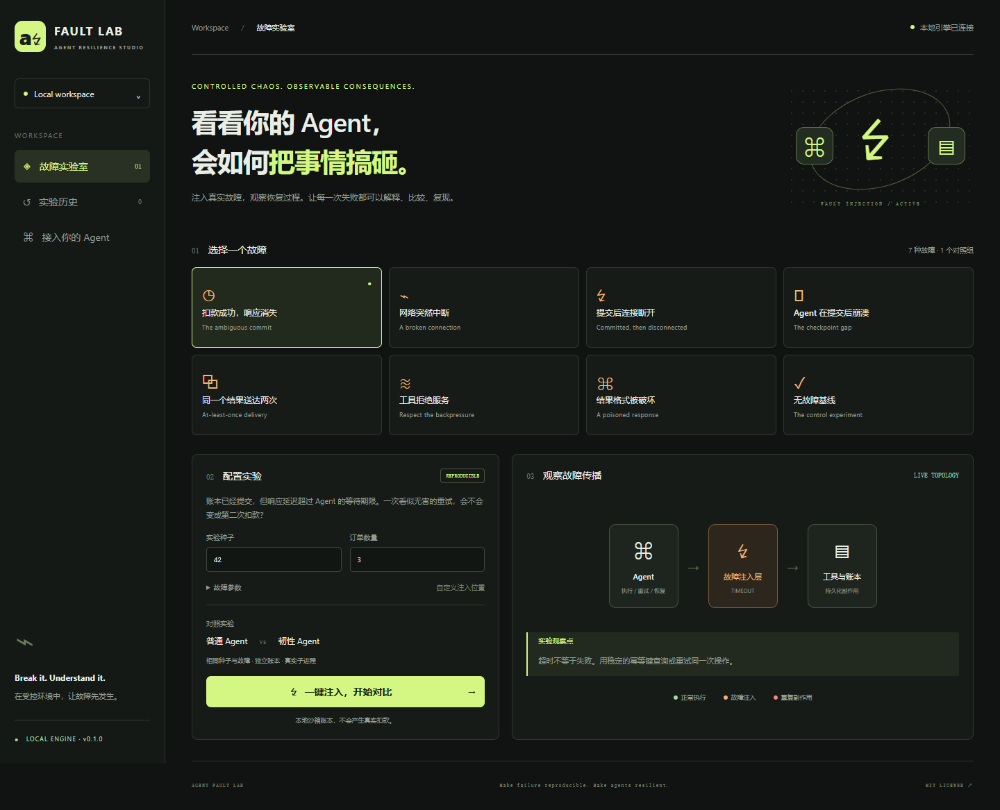

# Agent Fault Lab · Agent 故障实验室

**一键复现 Agent 如何把事情搞砸。** 给工具调用注入真实传输故障，终止真实 Agent 子进程，用持久化副作用账本判断恢复是否正确。

零生产依赖，无需 API Key。内置 Agent 是确定性订单执行器，不调用大模型；用它隔离并解释恢复协议问题。自己的 LLM Agent 可通过 HTTP 工具适配器或进程监督器接入。



## 快速开始

需要 **Node.js 22.13+（推荐 24 LTS）**。使用 Node 内置 SQLite，部分版本会显示 ExperimentalWarning。

```sh
npm start
# 打开 http://127.0.0.1:4318
```

无需 npm install。Windows 也可双击 `start.cmd`。选择故障，点击“一键注入，开始对比”。

```sh
npm run demo
npm test
npm run check
node src/cli.mjs run --scenario process-crash --strategy resilient --ci
node src/cli.mjs run --scenario lost-response --output report.json
node src/cli.mjs replay --file report.json
node src/cli.mjs supervise --scenario process-crash -- python examples/external_agent.py
```

`--ci` 在断言未通过时返回退出码 1；普通运行发现预期缺陷仍是一次成功的实验执行。

## 故障场景

| 场景 | 注入方法 | 普通 Agent 默认结果 | 韧性 Agent 默认结果 |
|---|---|---|---|
| lost-response | 提交后延迟响应，超过客户端期限 | 重复扣款 | 幂等重试 |
| network-partition | 提交前连续关闭两次 TCP 连接 | 重试恢复 | 退避恢复 |
| commit-disconnect | 提交后销毁 TCP 连接 | 重复扣款 | 幂等重试 |
| process-crash | 提交后终止受管理子进程，再重启 | 重复副作用 | 检查点 + 幂等 |
| duplicate-delivery | 一个响应中投递两份相同消息 | 重复回执 | 消费去重 |
| rate-limit | HTTP 429 + Retry-After | 快速重试 | 有界退避 |
| corrupt-response | 提交后返回截断 JSON | 重复扣款 | 幂等重试 |
| baseline | 不注入故障 | 通过 | 通过 |

界面提供并排对比、业务断言、SSE 实时事件、逐事件回放、拖动定位、相同参数重跑、JSON 导出和历史记录。默认三个订单，每单 99 元，全部金额为沙箱整数分。数据保存在 `.data/lab.sqlite`。

## 接入与复现

HTTP 契约见 [ADAPTERS.md](docs/ADAPTERS.md)，设计见 [ARCHITECTURE.md](docs/ARCHITECTURE.md)。`npm start -- --upstream http://127.0.0.1:8000` 可以启动固定上游工具代理。

种子决定默认故障调用序号；`--at` 覆盖序号，`--count` 指定连续故障次数，`--delay` 指定响应延迟（650–5000 ms）。匹配的是目标工具调用次数，包含重试，不是订单编号。默认 Agent 超时为 450 ms。

CLI replay 会重新执行实验；界面的“回放”播放已记录事件。指纹排除时间、进程号和 run ID，保留配置、语义事件与账本。内置串行 Agent 的语义轨迹可复现；外部并发、模型输出和系统调度不保证一致。原始 JSON 是原实验的证据。

## 边界

- 任意 Agent 需要将工具流量接入适配器；不是针对未知程序的内核级注入。
- 断网仅中断实验请求，不修改网卡或防火墙。崩溃仅终止直接受管理进程，不管理整个进程树。
- HTTP 代理有限缓冲（1 MiB 请求、2 MiB 响应、10 秒上游期限），不支持 SSE/WebSocket 流式转发，不跟随重定向。
- 代理看不到上游业务账本，报告为 **inconclusive**。只有沙箱账本能提供副作用断言。
- 幂等键须由服务端原子持久化，跨重试与重启保持稳定。本项目不宣称通用 exactly-once。
- 服务只监听回环地址。Origin/Host 校验不是多用户认证，不用于公网部署。

## 结构与贡献

`src/`：引擎、SQLite、监督器、API、CLI；`public/`：无构建依赖的中文实验台；`examples/`：JS 与 Python Agent；`test/`：集成测试。

提交前运行 `npm test` 和 `npm run check`。新故障应检查真实账本，而不只断言事件名称。可选浏览器测试：安装 Playwright 和 Chromium 后运行 `npm run test:e2e`。

核心 API：[Node.js SQLite](https://nodejs.org/api/sqlite.html)、[child_process](https://nodejs.org/api/child_process.html)。许可：[MIT](LICENSE)。
