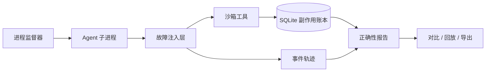

<div align="center">

# Agent Fault Lab
### Agent 故障实验室

**一键复现 Agent 如何把事情搞砸。**

给 Agent 注入真实故障，用事件轨迹与副作用账本检验恢复是否正确。

[](https://github.com/KardeniaPoyu/agent-fault-lab/actions/workflows/test.yml)
[](https://nodejs.org/)
[](LICENSE)

**简体中文** · [English](README.en.md)

[快速开始](#快速开始) · [故障场景](#故障场景) · [接入你的-agent](#接入你的-agent) · [架构设计](docs/ARCHITECTURE.md) · [参与贡献](CONTRIBUTING.md)

</div>

## 在线体验

**[打开在线演示 →](https://kardeniapoyu.github.io/agent-fault-lab/)** · 无需登录、安装或 API Key。

在线版是明确标注的**浏览器协议模拟**，支持八种场景、策略对比、事件回放、JSON 导出与浏览器本地历史。不会运行真实子进程、断开 TCP 连接或调用远程工具；模拟结果不构成真实 Agent 的可靠性证明。真实故障注入请使用下方本地快速开始。

在线演示由 GitHub Pages 托管，推送 `main` 后自动更新。开发时执行 `npm run build:demo` 生成 `dist/`，通过静态 HTTP 服务预览；`npm run test:demo` 将模拟器与本地引擎逐场景对比。


## 为什么需要它

工具返回超时，不代表操作没有成功。Agent 重新调用一次付款工具，可能真的扣两次款；进程在提交后、保存检查点前崩溃，重启也可能重复发送通知。

Agent Fault Lab 把这些难以复现的边界条件变成可控实验：**注入故障 → 观察重试或重启 → 检查实际副作用 → 导出证据 → 使用相同参数复现**。

内置普通 Agent 与韧性 Agent 对照组。前者故意缺少幂等与检查点，后者展示稳定幂等键、有界退避、检查点恢复和消息去重。它们是确定性订单执行器，不调用大模型，因此无需 API Key，也便于隔离恢复协议问题。

## 核心能力

- **真实故障注入**：HTTP 响应延迟、TCP 断连、受管理子进程终止、重复消息、429 限流和损坏 JSON。
- **一键对照实验**：相同故障配置与种子，独立进程和账本，比较恢复结果。
- **以副作用判断正确性**：检测重复业务操作、缺失操作、扣款金额、退出状态及故障是否实际触发。
- **可观察、可回放**：实时 SSE 事件、逐事件播放、拖动定位、历史记录、JSON 报告与语义指纹。
- **框架无关接入**：HTTP 沙箱工具、固定上游代理，以及支持任意可执行文件的进程监督器；附 JavaScript / Python 示例。
- **轻量本地运行**：零生产依赖，无前端构建步骤，SQLite 持久化，中文界面适配桌面与手机。

## 快速开始

需要 **Node.js 22.13+**，推荐 24 LTS。Python 仅在运行 Python 示例时需要。

```sh
git clone https://github.com/KardeniaPoyu/agent-fault-lab.git
cd agent-fault-lab
npm start
```

打开 **http://127.0.0.1:4318**，选择“扣款成功，响应消失”，点击“一键注入，开始对比”。不需要执行 `npm install`。Windows 用户也可以双击 `start.cmd`。

默认实验处理三个订单，每单 99 元。所有扣款都只是本地沙箱账本中的整数分，不涉及真实支付。

```sh
# 不打开浏览器，直接运行对照实验
npm run demo

# 检查韧性 Agent 的崩溃恢复；断言失败时退出码为 1
node src/cli.mjs run --scenario process-crash --strategy resilient --ci

# 保存原始证据，再以相同配置重跑
node src/cli.mjs run --scenario lost-response --output report.json
node src/cli.mjs replay --file report.json
```

默认响应丢失实验的关键结果如下（耗时、进程号与指纹随配置或运行环境变化）：

```text
naive      FAILED | charges=4 duplicateEffects=1 retries=1 restarts=0
resilient  PASSED | charges=3 duplicateEffects=0 retries=1 restarts=0
```

这里的 `FAILED` 表示发现 Agent 恢复协议的问题；实验室本身完成了实验。只有传入 `--ci` 时，断言失败才会导致命令退出码为 1。

## 故障场景

| 场景 ID | 实际注入方法 | 普通 Agent 默认表现 | 韧性 Agent 默认表现 |
|---|---|---|---|
| `lost-response` | 提交后延迟响应，超过客户端期限 | 重复扣款 | 幂等重试 |
| `network-partition` | 提交前连续关闭两次 TCP 连接 | 快速重试恢复 | 退避恢复 |
| `commit-disconnect` | 提交后销毁 TCP 连接 | 重复扣款 | 幂等重试 |
| `process-crash` | 提交后终止受管理子进程，再重启 | 重复副作用 | 检查点 + 幂等 |
| `duplicate-delivery` | 一个响应中投递两份相同消息 | 重复回执 | 消费去重 |
| `rate-limit` | 返回 HTTP 429 与 Retry-After | 快速重试 | 尊重退避时间 |
| `corrupt-response` | 提交后返回截断 JSON | 重复扣款 | 幂等重试 |
| `baseline` | 不注入故障 | 通过 | 通过 |

重复返回通过 `deliveries` 消息数组明确建模，并非把一个 HTTP 请求伪装成收到两次独立 HTTP 响应。

## 实验如何工作



故障可发生在提交前或提交后。后者制造最关键的不确定性：**服务端已提交，客户端却没有拿到成功结果**。

账本通过事务及唯一约束持久化幂等结果；Agent 重试时携带稳定业务操作标识与幂等键。检查点负责恢复进度，幂等键负责覆盖“远程操作已成功、检查点还没写入”的缺口。详细设计见 [ARCHITECTURE.md](docs/ARCHITECTURE.md)。

## 接入你的 Agent

### 方式一：HTTP 沙箱工具

创建外部实验，使用返回的 `toolBaseUrl` 和 `token` 调用工具：

```http
POST /api/runs
Content-Type: application/json

{"strategy":"external","scenario":"lost-response"}
```

```http
POST {toolBaseUrl}/tools/charge
Content-Type: application/json
X-Lab-Token: {token}

{"operation":"order-1:charge","idempotencyKey":"order-1:charge","amount":9900}
```

`operation` 标识同一个业务动作，供重复检测使用；`idempotencyKey` 供服务端阻止重复提交。重试时两者都应保持稳定。未受监督的外部 Agent 完成后需调用 `POST {toolBaseUrl}/complete`。

### 方式二：真实进程崩溃与恢复

```sh
node src/cli.mjs supervise --scenario process-crash -- python examples/external_agent.py
```

监督器向直接子进程传入 `LAB_URL`、`LAB_TOKEN`、`LAB_CONFIG`，负责终止与重启。不通过 shell 拼接命令。

### 方式三：现有 HTTP 工具代理

```sh
npm start -- --upstream http://127.0.0.1:8000
```

创建外部实验后，将工具请求指向 `{toolBaseUrl}/proxy/原路径`。使用可丢弃的测试上游与数据。代理无法读取上游业务账本，因此只报告传输证据，最终结论为 **inconclusive**，不会把“没有观察到重复”当成安全证明。

完整响应格式、鉴权、消息封装、检查点和 SSE 契约见 [ADAPTERS.md](docs/ADAPTERS.md)。

## 配置与复现

| 参数 | 含义 | 默认值 / 范围 |
|---|---|---|
| `--seed` | 决定默认故障调用序号的种子 | `42`，1–64 字符 |
| `--orders` | 沙箱订单数量 | `3`，1–10 |
| `--at` | 从第几次目标工具调用开始注入 | 由种子计算，1–50 |
| `--count` | 连续注入次数 | 场景默认；故障场景 1–8，基线 0 |
| `--delay` | 超时场景的响应延迟（ms） | `900`，650–5000 |
| `--port` | HTTP 服务端口 | `serve` 默认 4318 |
| `--db` | SQLite 文件路径 | `serve` 默认 `.data/lab.sqlite` |
| `--output` | 将报告保存为 JSON | 默认不写文件 |
| `--ci` | 断言未通过时返回非零退出码 | 默认关闭 |

故障序号统计目标工具调用，**包含重试，不是订单编号**。默认内置 Agent 请求期限为 450 ms，每个操作最多尝试五次，最多重启两次。内置实验总预算为 20 秒，外部实验为 120 秒。

CLI `replay` 会重新执行实验；界面的“回放”播放已有记录。语义指纹排除时间戳、进程号和 run ID，保留配置、事件语义与账本。外部并发、模型输出和系统调度不保证一致；请保留原始 JSON 作为原实验的证据。

## 开发与验证

```sh
npm test
npm run check

# 可选：安装浏览器测试依赖，不影响零依赖启动
npm install --no-save playwright
npx playwright install chromium
npm run test:e2e
```

核心测试覆盖八种场景的两种策略、持久化幂等、配置复现、请求校验、代理转发、SSE 续传和并发幂等。浏览器测试覆盖对照结果、回放、历史、接入说明与手机布局。GitHub Actions 配置为 Windows / Ubuntu × Node.js 22 / 24；以上方实际工作流状态为准。

```text
src/        故障引擎、账本、监督器、HTTP API、CLI
public/     无构建依赖的可视化实验台
examples/   JavaScript 对照 Agent、Python 外部 Agent
scripts/    语法检查、浏览器测试
test/      HTTP、进程、持久化与代理集成测试
docs/      接入契约、架构说明与截图
```

## 能力边界

- 任意 Agent 需要接入工具适配器；本项目不是针对未知程序的内核级注入器。
- 断网只中断实验连接，不修改电脑网卡或防火墙。崩溃只终止直接受管理子进程，不管理整个进程树。
- 代理有限缓冲：1 MiB 请求、2 MiB 响应、10 秒上游期限；不支持 SSE / WebSocket 流式转发，不跟随重定向。
- 外部 Agent 的任务完成是自报告；通用副作用检测不能代替领域任务断言。
- SQLite 账本提交与遥测事件写入不是同一事务；服务端崩溃可能留下没有对应事件的已提交副作用，账本仍是事实来源。
- 幂等键必须由服务端原子持久化，本项目不宣称通用分布式 exactly-once。
- 服务只监听回环地址，面向可信本地开发。Host / Origin 检查不是多用户认证，勿直接部署到公网。详见 [SECURITY.md](SECURITY.md)。

## 贡献与许可

欢迎贡献故障场景、Agent 适配器、复现案例和回归测试。请先阅读 [CONTRIBUTING.md](CONTRIBUTING.md)，或通过 [Issues](https://github.com/KardeniaPoyu/agent-fault-lab/issues) 提交可复现的问题。

基于 [Node.js SQLite](https://nodejs.org/api/sqlite.html) 与 [child_process](https://nodejs.org/api/child_process.html) 构建。采用 [MIT License](LICENSE)。
