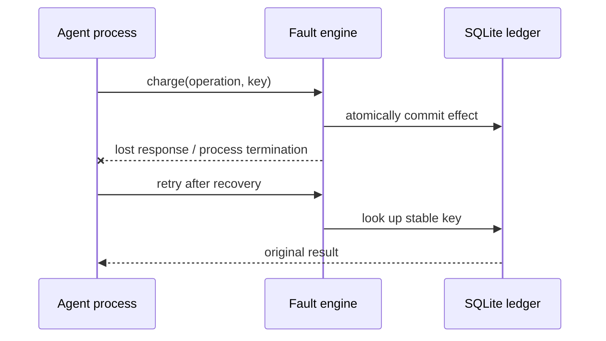

# Architecture

Before faults run before the business effect; after faults run after durable commit. Naive agents retry without keys, lack durable checkpoints and consume duplicate deliveries. Resilient agents use stable keys, bounded backoff, checkpoints and message deduplication.

SQLite uses WAL, synchronous=FULL, a unique `(run,key)` constraint and BEGIN IMMEDIATE. Reusing a key with different payload is rejected. Ledger commit precedes telemetry: a server crash may leave an effect without its event. The ledger is authoritative. Server restart marks unfinished experiments interrupted.

Each run owns its schedule, token, ledger, trace and process. At most four active experiments. Built-in agents have a 20-second total budget, five attempts per tool operation and two process restarts. External agents have 120 seconds. Ordinals count calls including retries. External concurrency can change ordering.

A successful process exit can still produce a failed report. Assertions independently check at-most-once business effects, completion, amount and bounded exit. Proxy-only reports cannot establish business correctness.

Semantic fingerprints exclude time, PID, run ID and key text; preserve configuration, semantic events and effects. Heavy system load can create additional timeouts and different fingerprints. Exported reports retain original evidence. This is an educational and testing harness, not a proof of distributed exactly-once execution.
